# Headless paint on a minimal brief, November 2026: a baseline, a diagnosis, a fix

This folder holds one measurement and what was done about it, in the order it happened.

1. **The baseline.** On one landing-page brief asking for a minimal, restrained style, run headless, genjutsu 4.1.3's `paint` came last: behind Anthropic's `frontend-design` skill and behind no plugin at all, in both rounds, at about 3.7 times the cost of a no-plugin run.
2. **The diagnosis.** With nobody to ask, `paint` removed the picture of the product and put nothing in its place. Restraint came out as absence.
3. **The change.** A branch of genjutsu (v4.2.0) makes the thesis name a first screen, colour roles, the one motion and what stands in place of anything an assumption removes, and adds a static reading of the page before the audit.
4. **Three tuning rounds.** The branch was run and scored blind three times, and its rules were edited between rounds. Every run and every score is here.
5. **Round 3.** The two new pages score 2.3 and 3.3 points out of 10 above the 4.1.3 pages, 1.7 and 2.0 above the no-plugin pages, and level with `frontend-design` (0.2 and 0.5 ahead, inside the judges' noise). A run now costs about 4.3 times a no-plugin run.
6. **Round 4.** The round 3 pages put an example invoice on the first screen and invented its quantities and prices, on a brief that says "invent no other figure". The text was also edited from review after round 3. Round 4 ran that edited text twice as it stood (arm A) and twice with one more sentence that bounds the example to what the brief gives (arm B). Both arm B pages show an example made of words, with no figure the brief does not give; both arm A pages still invent quantities and prices. The judges were told this time to weigh "invent no figure" as the brief's author would. Under that instruction arm B scores 8.0 and 7.83, first in both sets, and arm A 6.5 and 6.83. Arm B's text is the v4.2.0 text. Round 4 scores are not comparable with rounds 1 to 3.

Read ["What this does not show"](#what-this-does-not-show) before quoting any of it. The short version: one brief, two runs per arm, a model as judge, rules tuned on that same brief, an example invoice with invented values through round 3, and a round 4 whose judging instruction points at the very thing its arm B was written to fix.

## Before and after

First screens at 1440x900, genjutsu `paint` on the same prompt. Left: 4.1.3. Right: the branch in round 3. Each row is one blind set as the judges saw it (the sets are crossed: candidate run 1 was judged with 4.1.3 run 2, and candidate run 2 with 4.1.3 run 1).

| genjutsu 4.1.3 | Branch, round 3 |
|---|---|
| 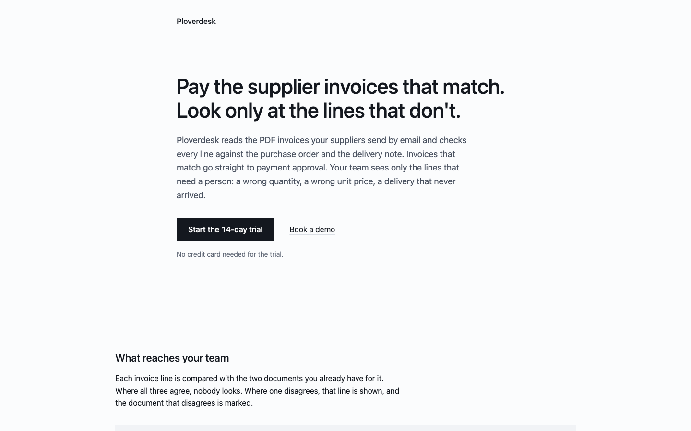 | 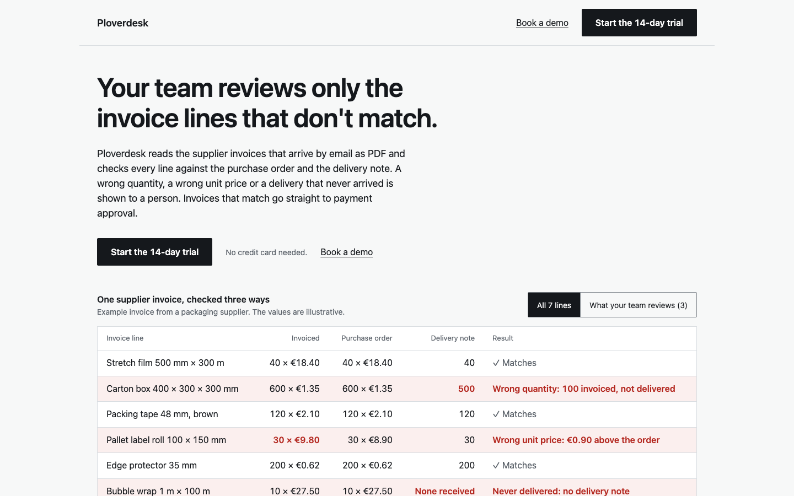 |
| [`minimal-saas-genjutsu-2`](./minimal-saas-genjutsu-2/receipt.md), mean 5.17 | [`minimal-saas-candidate-r3-1`](./minimal-saas-candidate-r3-1/receipt.md), mean 7.5 |
| 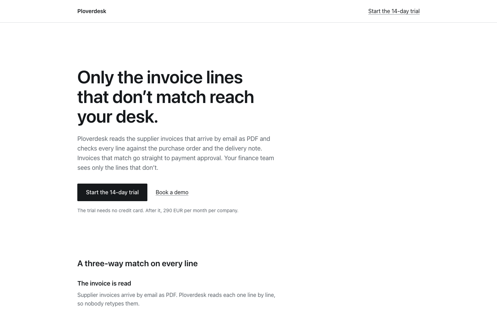 | 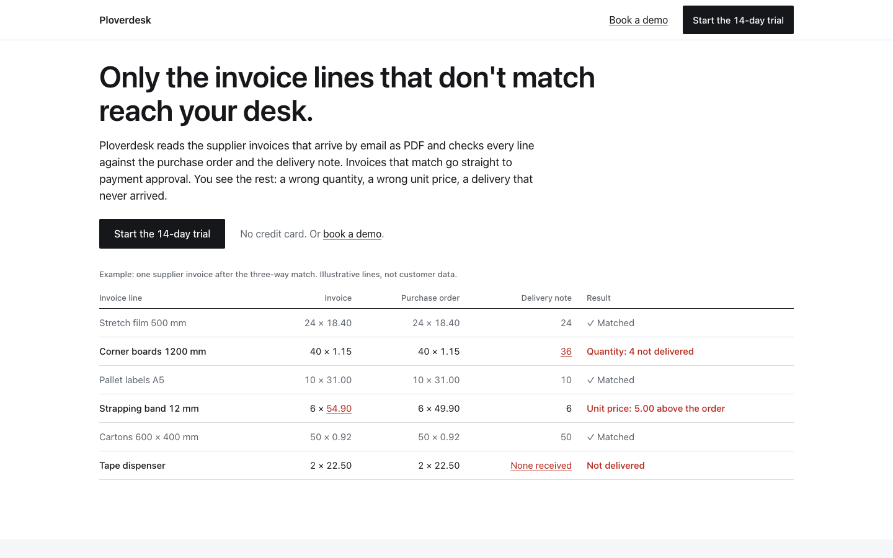 |
| [`minimal-saas-genjutsu-1`](./minimal-saas-genjutsu-1/receipt.md), mean 4.33 | [`minimal-saas-candidate-r3-2`](./minimal-saas-candidate-r3-2/receipt.md), mean 7.67 |

Whole pages, 1440 px wide, same order:

| genjutsu 4.1.3 | Branch, round 3 |
|---|---|
| 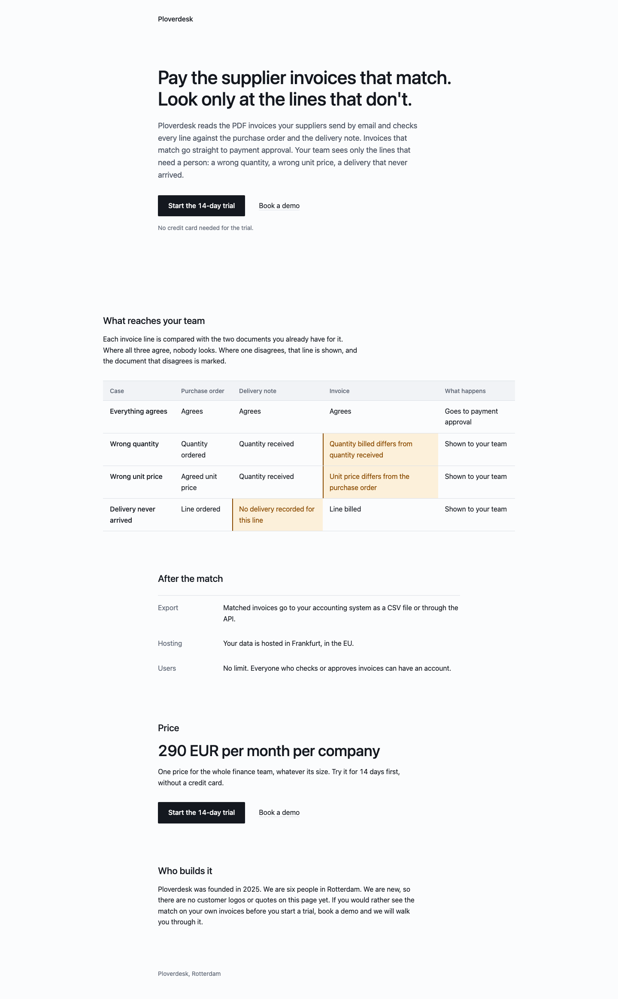 | 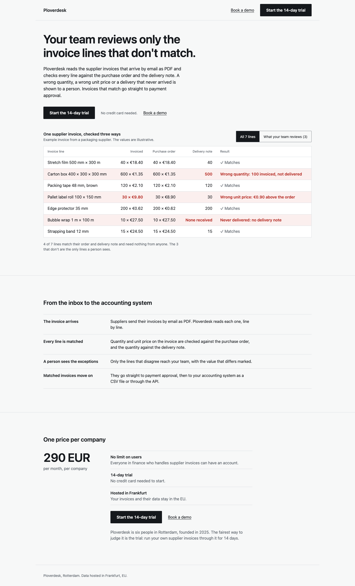 |
| 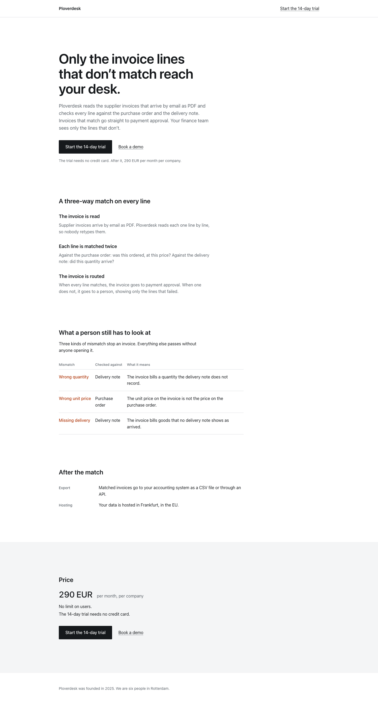 | 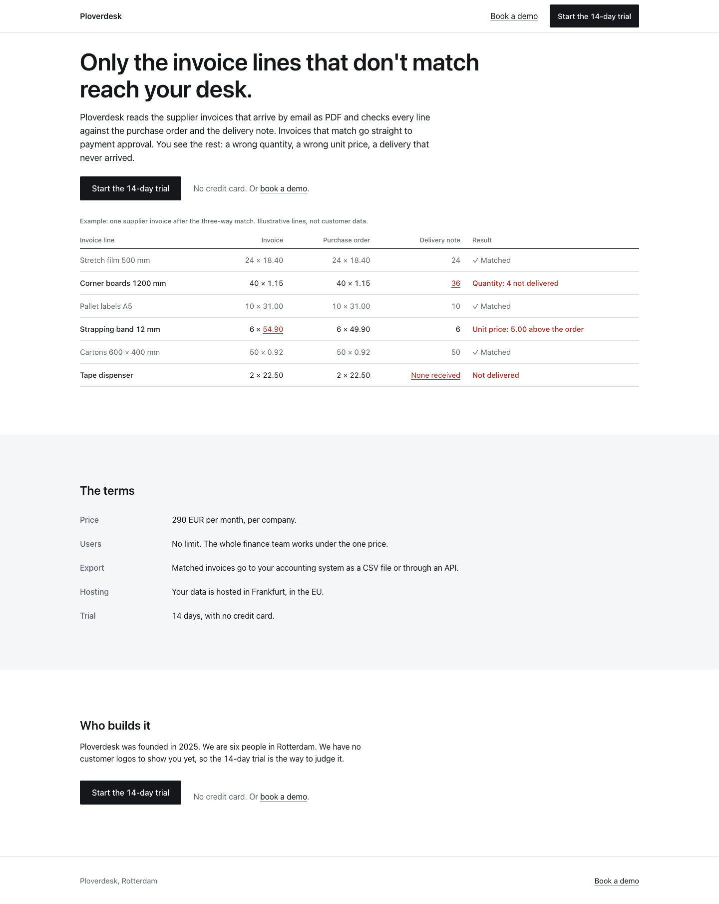 |

For comparison, the two `frontend-design` first screens the candidate was tuned against. They did not change between rounds:

| frontend-design, run 1 | frontend-design, run 2 |
|---|---|
| 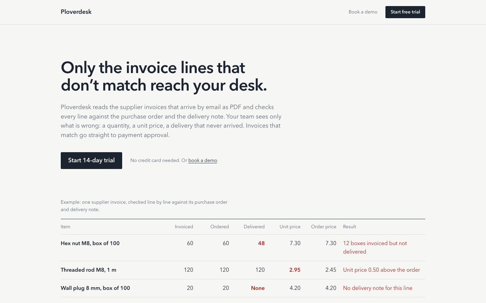 | 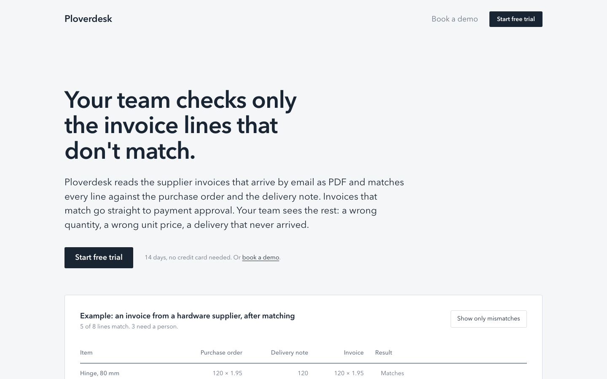 |

The round 3 pages are close to these: an example invoice set as a ruled table, the lines that match in grey, the values that disagree in red. Candidate run 2 and `frontend-design` run 1 have the same headline, word for word ("Only the invoice lines that don't match reach your desk.").

The round 4 pages, where the example carries no invented figure, are in [section 6](#6-round-4-the-example-without-invented-figures).

## 1. The baseline

### What was run

Eight runs: `claude-opus-5-5`, Claude Code 2.1.323, `claude plugin eval` headless with the flags of [`bin/run.sh`](../bin/run.sh) (`--ablation none --scaffold --allow-tools Bash Write Edit`), launched on 2026-11-13 through [`bin/run-arm.sh`](./bin/run-arm.sh). Same fixture for every arm (the empty React 19 + Vite + TypeScript template), same prompt, one difference: the genjutsu arm's prompt opens with `/genjutsu:paint`, the others with the bare request.

| Arm | Plugin under test | Prompt |
|---|---|---|
| none | [`arms/none/plugin`](./arms/none/plugin/.claude-plugin/plugin.json): a manifest and nothing else | bare |
| frontend-design | Anthropic's `frontend-design` 1.1.1, from the `claude-plugins-official` marketplace | bare; the skill is not named, it triggered by itself in both runs |
| genjutsu | genjutsu 4.1.3 at `5e00595` | `/genjutsu:paint` + the same text |

The case is [`cases/minimal-saas`](./cases/minimal-saas/prompt.md): the landing page of Ploverdesk, a fictional B2B SaaS that matches supplier invoices against purchase orders, with the facts a client would give, the line "they want it minimal and restrained. Quiet, precise, nothing decorative." and the line "invent no other figure". The prompt was written before any run and never changed.

**Isolation.** `claude plugin eval` runs each session in its own temporary home, so nothing from the machine's Claude configuration is loaded. Each run folder keeps the proof in `runs/<stamp>/trace-facts.json`, taken from the init event of the run's trace: the skill list of the `none` runs holds only Claude Code's 17 built-in skills; the `frontend-design` runs add exactly `frontend-design:frontend-design`; the genjutsu runs add exactly `genjutsu:paint`, `genjutsu:cast` and `genjutsu:bunshin`. No MCP server in any run.

Nothing in the baseline was tuned, re-run or selected: every baseline run launched is here. That is not true of the candidate below, which was tuned.

### Costs

| Run | Cost | Turns | Duration |
|---|---|---|---|
| [`minimal-saas-none-1`](./minimal-saas-none-1/receipt.md) | $0.46 | 12 | 110 s |
| [`minimal-saas-none-2`](./minimal-saas-none-2/receipt.md) | $0.46 | 14 | 102 s |
| [`minimal-saas-frontend-design-1`](./minimal-saas-frontend-design-1/receipt.md) | $0.64 | 13 | 166 s |
| [`minimal-saas-frontend-design-2`](./minimal-saas-frontend-design-2/receipt.md) | $0.68 | 17 | 167 s |
| [`minimal-saas-genjutsu-1`](./minimal-saas-genjutsu-1/receipt.md) | $1.73 | 29 | 308 s |
| [`minimal-saas-genjutsu-2`](./minimal-saas-genjutsu-2/receipt.md) | $1.64 | 24 | 267 s |
| [`invoice-mark-paid-none-1`](./invoice-mark-paid-none-1/receipt.md) | $0.91 | 19 | 211 s |
| **Total launched for the baseline** | **$6.52** | | |

genjutsu 4.1.3 cost 3.6 to 3.8 times a no-plugin run. The genjutsu arm of the cast pair was not launched here: it is the run of 2026-10-04 already in [`../invoice-mark-paid/`](../invoice-mark-paid/receipt.md) ($1.88, 45 turns, 329 s).

All seven new runs built with `npm ci && npm run build` on the first try, unchanged. None could build in its own sandbox (npm and node are blocked there), so none of them saw its page. The second genjutsu run failed the `paint-loaded` grader (score 0.67); the first passed all three.

### Tells audit

`python3 skills/_jutsu/design-audit/scripts/audit.py <workspace> --group tells`, from genjutsu 4.1.3, on each workspace (`tells.md` and `tells.json` in each run folder). 18 checks each. One tell in the eight workspaces: a U+2014 in displayed text (an `aria-label`) in `minimal-saas-none-1`. The other seven come back with 0.

The audit does not separate the arms. It also misses things the eye sees at once in the no-plugin pages: three steps numbered 01, 02, 03 over three equal columns in `none-1`, a U+2014 in the page title of `none-2` (in `index.html`, outside the folder the audit reads). A page can pass all 18 checks and still be the default page.

### The three arms side by side

Left to right in every image: **none, frontend-design, genjutsu 4.1.3**. Stills by genjutsu's `shoot.mjs` through [`bin/capture.sh`](./bin/capture.sh), on macOS, at least 4 seconds after load so that on-load motion has ended. Each run folder holds the full-size stills in `media/`.

Run 1 of each arm, first screen at 1440x900, then the whole page at 1440 px and at 390 px:

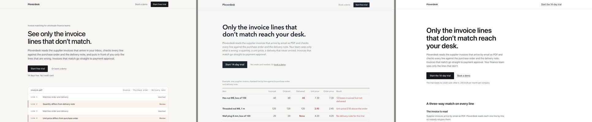

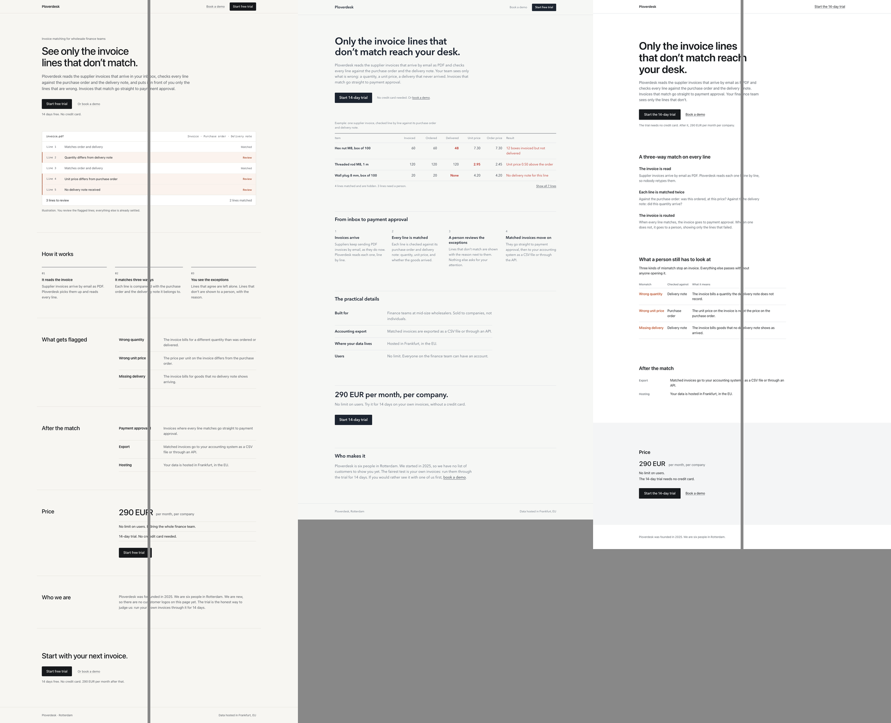

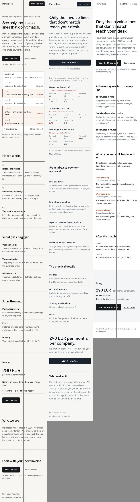

Run 2 of each arm, same three views:

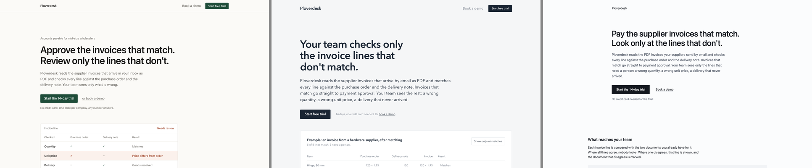

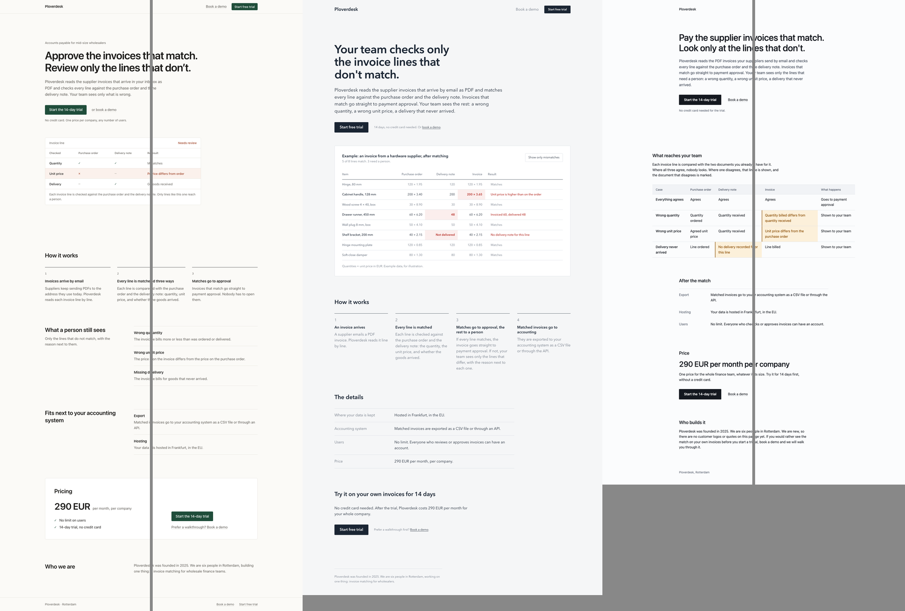

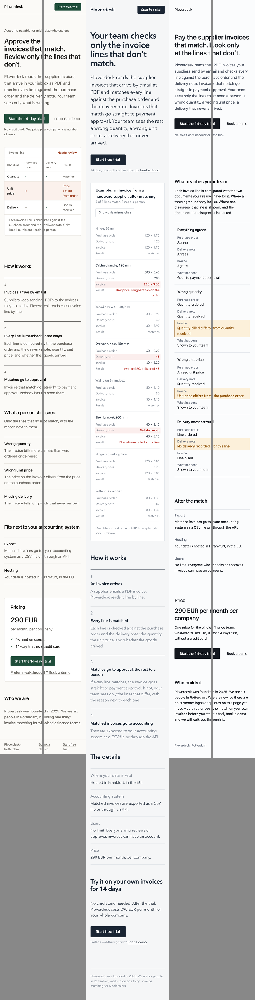

### Read by eye

Written by the agent that ran the baseline (Claude), from the screenshots, before any blind scoring existed, with the instruction not to be kind to genjutsu. One reader, not a panel.

**none.** "Clean, and I have seen it a hundred times." Both runs give the same page: an eyebrow line, a two-line headline, a grey paragraph, a dark button with a quiet link, a bordered card under the hero that imitates the product, three numbered steps in three columns, then title-left, list-right sections on warm off-white with one rust accent. The card under the hero is the one useful thing: in run 1 it shows five invoice lines with three flagged, and you understand the product from it. With the copy removed nobody could say which product the page is for. It is the default "minimal SaaS" template, competently filled in. It is also complete, legible on a phone, and persuasive enough.

**frontend-design.** "The table is the page, good." Both runs put a worked example at the centre: a supplier invoice set as a ruled table with its order and delivery figures, where the lines that match recede (in run 1 they fold away 1.6 s after load, leaving three) and the figures that disagree are red with the reason written beside them. That is one identifiable idea and it is the product's own promise acted out. Red is used for nothing else. Below the example both runs fall back to standard furniture, and the type scale is timid. Two reservations. The example invents quantities and prices, which the brief forbids ("invent no other figure"); both runs said so themselves and labelled the data as an example. And Avenir Next is a font of Apple systems, not a web font: off a Mac the page loses it.

**genjutsu 4.1.3.** "This is the wireframe; where is the design?" Run 1 is a narrow left column of system sans on white: a headline, a paragraph, a button, then text blocks, with no picture of the product, no example, and more than a third of a 1440 px screen left empty from top to bottom. Run 2 is better (a table of cases with the disagreeing document tinted amber) but the table describes cases in words instead of showing an invoice, sits below the first screen, starts 128 px to the left of everything else, and the header holds the name and nothing more. Neither page has an identifiable visual idea on its first screen. What they do well is not visible in a screenshot and is taken from the code and the runs' own reports: tokens in one file, contrast computed from the colour values, 44 px targets, a reduced-motion path, one label per action, no invented figure, no U+2014, and a plain list of what was not verified.

**Ranking, both runs:** frontend-design first, none second, genjutsu third. The blind scores taken later agree with this order on the baseline pages in all three judging rounds (see section 4).

On the question that prompted this baseline (a public video judged a minimal genjutsu page "closer to a typical AI design"): these two genjutsu pages do not look like the typical generated SaaS page, the no-plugin pages do. But they are not better for it. They avoid the template by leaving things out.

### The cast pair

Fixture `invoice-mark-paid` (the Folio invoice list whose "Mark as paid" does nothing visible). Left: the no-plugin run of this baseline. Right: the genjutsu run of 2026-10-04. Same click (FOL-2026-032, Overdue, 4,200.00 EUR), stills at 120 ms, 350 ms, 800 ms and 3 s after it, by [`bin/capture-cast.sh`](./bin/capture-cast.sh).

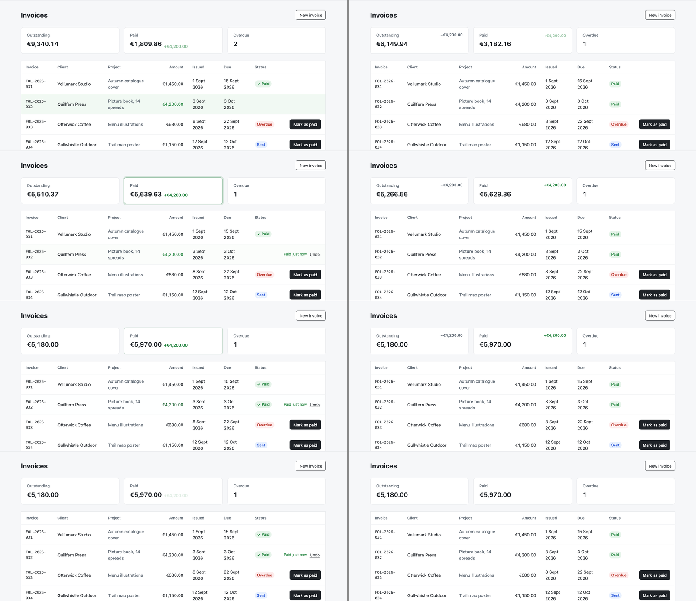

**none.** The row turns pale green and fades back, its amount goes green, a check mark draws itself in the Paid pill, the Paid card takes a ring and a "+€4,200.00" while Paid counts up and Outstanding counts down, and "Paid just now, Undo" replaces the button for eight seconds. It answers "make it feel like the money landed" literally, at the place you clicked. It is also busy (four confirmations for one click), and it added an Undo and a check mark on every Paid pill that nobody asked for.

**genjutsu.** One idea, stated in its thesis and visible in the stills: the amount leaves Outstanding (−€4,200.00) and lands in Paid (+€4,200.00) while both totals count. The pill is already Paid at 120 ms, the button is gone, nothing else moves. It gives nothing on the row itself, so the eye, which is on the row, has to travel up to the cards; and it has the focus defect recorded in its receipt.

**Ranking, cast pair:** none first by a short head, genjutsu second, with low confidence: stills cannot judge easing or rhythm. There is no visible advantage for genjutsu here, and the genjutsu run cost twice as much ($1.88 against $0.91). The pair is not clean either: the genjutsu arm is a month older (genjutsu 4.1.0, Claude Code 2.1.289). Nothing in the rest of this document touches `cast`: it was not changed for this and not run again.

## 2. What was diagnosed

The cause is in the run's own notes. `MASTER.md` of genjutsu 4.1.3 run 1, assumption A6: "No product screenshot exists, and no figure may be invented, so the page shows no drawn product UI and no example numbers." genjutsu's tells module lists "a fake product drawn in divs" among the patterns to read for, and the question it attached was "does a real screenshot, recording or component of the product exist, and if not, does the page need a picture of it at all?" The brief also forbids invented figures. With nobody to ask, `paint` answered no to both and removed the element that carries the other arms' pages, without putting anything in its place.

In order of weight, on this brief:

1. **Imagery.** No first-screen visual. The other arms answered with a labelled example of the product's own data, set as a document, not as fake chrome. `paint` had a prohibition for this situation and no positive rule.
2. **Layout.** One narrow column with the rest of a desktop screen unused (run 1), two unrelated left edges and a header with nothing in it (run 2), a first phone screen that ends in empty space.
3. **Typography.** The system sans at two weights with small size steps. Defensible (no network in the run), but it gives the page no voice.
4. **Motion.** None beyond hovers. `frontend-design`'s one motion (matched lines folding away once) carries its idea; `paint` did not consider motion as a way to state the idea.
5. **Colour and copy.** Fine in every arm, no difference worth reporting.
6. **Cost.** $1.64 to $1.73 against $0.46 to $0.68 for the other arms, spent on previews, a design-system file and an audit, none of which shows in the page.

The diagnosis was made by reading the winning pages as well as the losing ones. That matters for what follows: the rules were written knowing what the `frontend-design` pages look like.

## 3. What changed in the plugin (v4.2.0)

Nine commits on the genjutsu branch `feat/headless-presence`, on top of v4.1.4 (`d5c614a`), in five files: `skills/paint/SKILL.md`, the tells module and its web reference, and two shared regions that `cast` and `bunshin` carry too. In plain terms:

- **Tells.** A tell that is taken out leaves a place the thesis must fill. The question attached to "a fake product drawn in divs" no longer ends on "does the page need a picture of it at all?": it asks what in the project's own material can show what the product does, labelled for what it is.
- **When nobody is answering** (shared by `cast`, `paint`, `bunshin`). A prohibition in the brief is read at the scope it states, never wider, and when an assumption takes something out (a picture, a motion, a chosen typeface), the thesis says what stands in its place.
- **Loading order** (shared). The tells module loads once the thesis is written, never before.
- **The paint thesis.** Before writing it, `paint` lists the page this category publishes by routine, its predictable opposite and five worlds the design could draw from, sets the obvious ones aside and prints one `Set aside: ... Kept: ...` line. The visual thesis then has to name the first screen (the one thing it shows that only this product could show, what it is made of, its wide and narrowest forms, its state at rest), the job of each colour, and the shared edges. The interaction thesis names the one motion: its trigger and the state the page is in if it never runs.
- **Building.** A wide block gets its narrowest form when it is written. An empty stretch is a decision the thesis states. A section adds something no earlier one showed. A value stays beside what names it.
- **A static reading before the audit.** Before the audit, `paint` reads the code it wrote and reports, with `file:line`, what the first screen shows at rest, the narrowest frame, each section, the colour roles and the empty stretches, and fixes what the thesis promised and the code does not hold.
- Eight red-flag lines that other rules already state were cut from `paint`. The file still grew, from 68,075 to 71,649 characters.

The validated thesis stays the only authority in conversation; these rules were written for, and measured on, the headless case. The release notes are the v4.2.0 entry of the genjutsu `CHANGELOG.md`.

**What was run is the branch, not the tag.** The three rounds ran the branch at `8d57853` (three commits), `e4c31a6` (six) and `5e3f9c4` (nine). Its manifest still said 4.1.4 at each of them, which is the version the receipts carry. Edits made after `5e3f9c4`, including those that came out of the review, were not run in rounds 1 to 3. Round 4 ran them, on `minimal-saas` only (section 6).

**Which text is v4.2.0.** Not the text of rounds 1 to 3: the list above describes that measured text, not v4.2.0 word for word. The v4.2.0 text is the one round 4 ran as arm B, the branch at `1548e63`: the nine commits above, three more that hold the review edits, the release notes and a README line (up to `164cd3e`, round 4's arm A, manifest 4.2.0), and one commit that bounds the first-screen example (section 6). The release adds merges on top of `1548e63` that do not touch `paint`'s thesis text; they edit native modules and add one audit check to `paint`, `cast` and `bunshin`, which no run here had.

What the review edits changed, against the list above: `First screen:` and `The one motion:` are labelled lines under a one-sentence thesis; the question of "a fake product drawn in divs" asks about the project's own material and keeps its last clause ("or does the page need a picture of it at all?"); the tells module loads once the thesis is written and, when someone is there to answer, validated; the limits in preserve and partial mode and the native reading were added; a report asked short keeps the six reading entries, one line each. `paint`'s `SKILL.md` is 73,208 characters at `164cd3e` and 73,572 at `1548e63`.

## 4. Three tuning rounds

### Method

Each round ran the branch four times with [`bin/run-arm.sh`](./bin/run-arm.sh), same model, harness and flags as the baseline: twice on `minimal-saas`, once on `etale-landing`, once on `nocturne-planetarium` (the two existing headless `paint` cases of this repository, [`../cases/`](../cases)). The rules were then edited and the next round run. Every run launched in these three rounds is kept: twelve candidate runs, no re-run, no selection.

Each round was scored blind in four sets:

| Set | Pages |
|---|---|
| M1 | candidate run 1, `frontend-design` run 1, none run 1, genjutsu 4.1.3 run 2 |
| M2 | candidate run 2, `frontend-design` run 2, none run 2, genjutsu 4.1.3 run 1 |
| E | `etale-landing`: the candidate run, and the published run of [`../etale-landing/`](../etale-landing/receipt.md) (genjutsu 4.1.0, 2026-10-04) |
| N | `nocturne-planetarium`: the candidate run, and the published run of [`../nocturne-planetarium/`](../nocturne-planetarium/receipt.md) (genjutsu 4.1.0, 2026-10-04) |

The judge is one Claude model in three reviewer roles (a designer, a founder, a reader hunting for generated-looking pages), each role in its own session, new sessions in every round. A judge was given the brief and three stills per page (first screen at 1440x900, whole page at 1440 px, whole page at 390 px) under a letter, with the letters shuffled in every round, and gave each page a score out of 10. No human scored anything. The baseline pages, the `frontend-design` pages and the two 4.1.0 pages never changed: they were scored again in every round, which is what the noise figures below come from.

The per-role scores and the map from letters to runs are in [`judging/scores.json`](./judging/scores.json), round 4 included. The map was rebuilt after judging by hashing the stills of each blind set against the `media/` folders. The judges' written notes are not published. The stills of the two 4.1.0 pages that the judges saw were shot again for this from the published workspaces, with the same script, and are not in this folder.

### Every mean

Mean of the three roles, out of 10. "new" is the candidate of that round.

**minimal-saas, set M1**

| Page | Round 1 | Round 2 | Round 3 |
|---|---|---|---|
| genjutsu, candidate run 1 (new each round) | 6.0 | 7.33 | 7.5 |
| frontend-design run 1 | 7.83 | 7.67 | 7.33 |
| none run 1 | 6.67 | 6.33 | 5.83 |
| genjutsu 4.1.3 run 2 | 4.83 | 4.83 | 5.17 |

**minimal-saas, set M2**

| Page | Round 1 | Round 2 | Round 3 |
|---|---|---|---|
| genjutsu, candidate run 2 (new each round) | 6.0 | 6.17 | 7.67 |
| frontend-design run 2 | 7.67 | 7.83 | 7.17 |
| none run 2 | 6.33 | 6.0 | 5.67 |
| genjutsu 4.1.3 run 1 | 4.17 | 4.33 | 4.33 |

**Held cases, one candidate run each**

| Page | Round 1 | Round 2 | Round 3 |
|---|---|---|---|
| etale-landing, candidate (new each round) | 7.17 | 7.33 | 7.5 |
| etale-landing, genjutsu 4.1.0 | 7.33 | 7.17 | 7.17 |
| nocturne-planetarium, candidate (new each round) | 4.83 | 8.33 | 6.83 |
| nocturne-planetarium, genjutsu 4.1.0 | 5.67 | 4.17 | 5.33 |

### What each round did

- **Round 1** (`8d57853`): clear the ground, name the first screen and the one motion, read the first screen before the audit. Both minimal pages reached 6.0: above the 4.1.3 pages, still below the no-plugin pages (6.67 and 6.33) and well below `frontend-design`. The nocturne run came out below the 4.1.0 page (4.83 against 5.67).
- **Round 2** (`e4c31a6`): shared edges, the first screen's narrowest form and resting state, narrowest forms for wide blocks, empty stretches as decisions, a reading that covers every section. Run 1 reached 7.33, run 2 only 6.17: the same rules, 1.2 points apart. One run of the two cost $3.07.
- **Round 3** (`5e3f9c4`): a job for each colour, real values on the first screen, what sets each block's width, a section adds something. Both runs passed 7.

### Cost of the candidate runs

| Run | Cost | Turns | Duration |
|---|---|---|---|
| [`minimal-saas-candidate-r1-1`](./minimal-saas-candidate-r1-1/receipt.md) | $2.14 | 36 | 382 s |
| [`minimal-saas-candidate-r1-2`](./minimal-saas-candidate-r1-2/receipt.md) | $2.02 | 27 | 366 s |
| [`minimal-saas-candidate-r2-1`](./minimal-saas-candidate-r2-1/receipt.md) | $1.97 | 32 | 399 s |
| [`minimal-saas-candidate-r2-2`](./minimal-saas-candidate-r2-2/receipt.md) | $3.07 | 34 | 639 s |
| [`minimal-saas-candidate-r3-1`](./minimal-saas-candidate-r3-1/receipt.md) | $1.99 | 32 | 412 s |
| [`minimal-saas-candidate-r3-2`](./minimal-saas-candidate-r3-2/receipt.md) | $1.94 | 29 | 409 s |
| [`etale-landing-candidate-r1-1`](./etale-landing-candidate-r1-1/receipt.md) | $3.13 | 36 | 624 s |
| [`etale-landing-candidate-r2-1`](./etale-landing-candidate-r2-1/receipt.md) | $2.71 | 38 | 550 s |
| [`etale-landing-candidate-r3-1`](./etale-landing-candidate-r3-1/receipt.md) | $2.92 | 40 | 632 s |
| [`nocturne-planetarium-candidate-r1-1`](./nocturne-planetarium-candidate-r1-1/receipt.md) | $2.90 | 36 | 587 s |
| [`nocturne-planetarium-candidate-r2-1`](./nocturne-planetarium-candidate-r2-1/receipt.md) | $2.47 | 36 | 554 s |
| [`nocturne-planetarium-candidate-r3-1`](./nocturne-planetarium-candidate-r3-1/receipt.md) | $3.08 | 45 | 699 s |
| **Total, twelve candidate runs** | **$30.34** | | |

All twelve built with `npm ci && npm run build` on the first try, unchanged, with 0 human edits, and the tells audit of the candidate checkout returns 18 checked, 0 to confront on each. The judging sessions are not in these figures.

## 5. The round 3 result

On `minimal-saas`, the branch at `5e3f9c4`, mean of three roles out of 10:

| Set | Candidate | frontend-design | none | genjutsu 4.1.3 |
|---|---|---|---|---|
| M1 | 7.5 | 7.33 | 5.83 | 5.17 |
| M2 | 7.67 | 7.17 | 5.67 | 4.33 |

- **Against genjutsu 4.1.3:** +2.33 and +3.33. Every one of the six votes (three roles, two sets) puts the new page above the old one.
- **Against no plugin:** +1.67 and +2.0, also in all six votes.
- **Against frontend-design:** +0.17 and +0.5. This is level, not ahead: see the first point of the next section. In set M1 one role of three still puts `frontend-design` first.
- **Held cases:** etale-landing 7.5 against 7.17 for the 4.1.0 page, nocturne-planetarium 6.83 against 5.33. One run each. The judges saw no regression; that is too few runs to say more.
- **Cost:** $1.99 and $1.94, against $1.73 and $1.64 for 4.1.3, $0.64 and $0.68 for `frontend-design`, $0.46 for no plugin. The factor over a no-plugin run went from about 3.7 to about 4.3. It did not go down.

What changed on the page is visible in the stills at the top: both new pages put an example invoice on the first screen, with the three kinds of mismatch the brief names in red, where the 4.1.3 pages had text only. Run 1 keeps its one motion for a toggle that hides the matching lines; run 2 plays it once on load (the matched lines settle from ink to grey) and rests in the final state if it never runs.

## 6. Round 4: the example without invented figures

### Why

Two things were open after round 3.

- **The example invented figures.** The brief says "invent none, and invent no other figure". Both round 3 pages showed an example invoice with made-up quantities and unit prices, labelled as illustrative. `paint` allowed "an example labelled as an example", and nothing in the text stopped the values.
- **The text had moved.** The review edits listed in section 3 were made after `5e3f9c4` and had never been run.

So round 4 has two arms, both on the edited text, with one difference between them.

| Arm | Plugin under test | Difference |
|---|---|---|
| A, `candidate-r4a` | the branch at `164cd3e` (manifest 4.2.0) | the edited text as it stood |
| B, `candidate-r4b` | `feat/headless-presence-bound` at `1548e63`, one commit on `164cd3e` | one line of `skills/paint/SKILL.md` changed |

The commit of arm B changes the `First screen` point of the visual thesis in two places. An example labelled as an example is now also "named in `Allowed patterns:`". And these sentences are added: "An example takes its values from the brief or the project. When the brief says to invent no figure, it carries no figure the brief does not give, and shows the mechanism with the brief's own material and words (the names of the things compared, the kinds of mismatch, the states), unless the thesis says otherwise with its reason."

### What was run

Four runs on `minimal-saas`, two per arm, launched together on 2026-11-13 with [`bin/run-arm.sh`](./bin/run-arm.sh): same model (`claude-opus-5-5`), same flags and same prompt as every other run here. All four are kept. Two things differ from rounds 1 to 3: Claude Code was 2.1.325 (2.1.323 before), and each run had a cost ceiling of 3.4 USD, which none reached. The held cases (`etale-landing`, `nocturne-planetarium`) were not run in round 4.

| Run | Arm | Cost | Turns | Duration |
|---|---|---|---|---|
| [`minimal-saas-candidate-r4a-1`](./minimal-saas-candidate-r4a-1/receipt.md) | A | $2.19 | 25 | 444 s |
| [`minimal-saas-candidate-r4a-2`](./minimal-saas-candidate-r4a-2/receipt.md) | A | $2.07 | 30 | 382 s |
| [`minimal-saas-candidate-r4b-1`](./minimal-saas-candidate-r4b-1/receipt.md) | B | $1.95 | 34 | 349 s |
| [`minimal-saas-candidate-r4b-2`](./minimal-saas-candidate-r4b-2/receipt.md) | B | $1.93 | 26 | 366 s |
| **Total, four runs** | | **$8.14** | | |

All four built with `npm ci && npm run build` on the first try, unchanged, with 0 human edits. All four passed the three graders (score 1.00). The tells audit returns 18 checked, 0 to confront on each. No sideways overflow, no console error. `minimal-saas-candidate-r4b-2` wrote three U+2014 (one in `MASTER.md`, two in a preview file, none on the page or in its final message); the committed copies hold the character reference. The judging sessions are not in these figures.

### What the pages show

First screens at 1440x900. Left: arm A. Right: arm B. Each row is one blind set.

| Arm A, without the bound | Arm B, with the bound (the v4.2.0 text) |
|---|---|
| 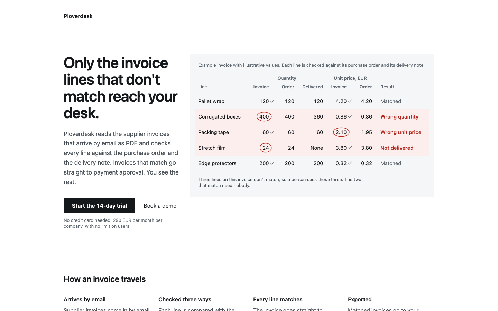 | 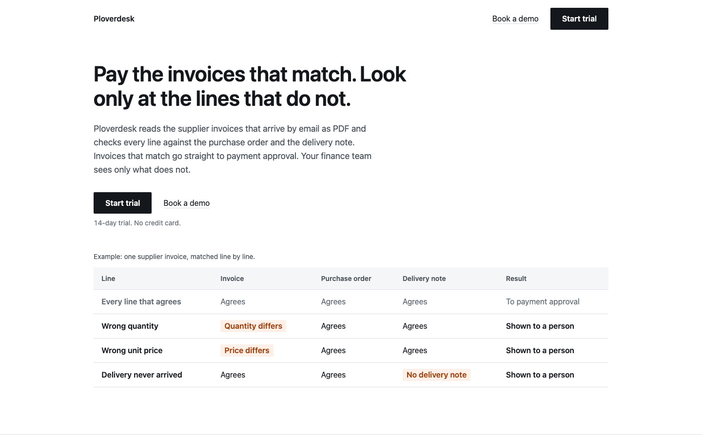 |
| [`minimal-saas-candidate-r4a-1`](./minimal-saas-candidate-r4a-1/receipt.md), set M1, mean 6.5 | [`minimal-saas-candidate-r4b-1`](./minimal-saas-candidate-r4b-1/receipt.md), set M1, mean 8.0 |
| 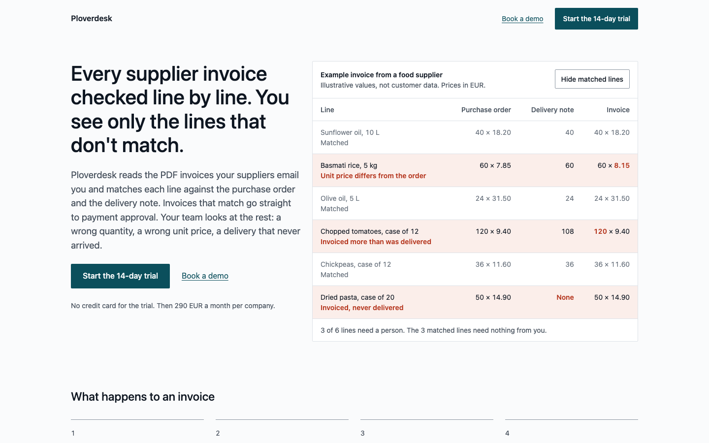 | 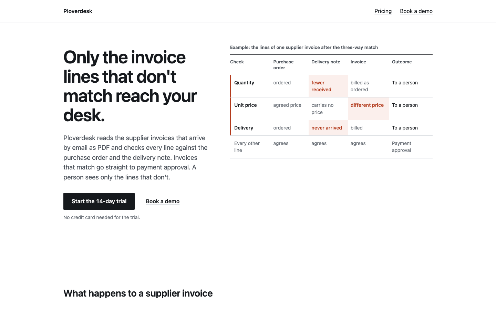 |
| [`minimal-saas-candidate-r4a-2`](./minimal-saas-candidate-r4a-2/receipt.md), set M2, mean 6.83 | [`minimal-saas-candidate-r4b-2`](./minimal-saas-candidate-r4b-2/receipt.md), set M2, mean 7.83 |

Whole pages, 1440 px wide, same order:

| Arm A, without the bound | Arm B, with the bound |
|---|---|
| 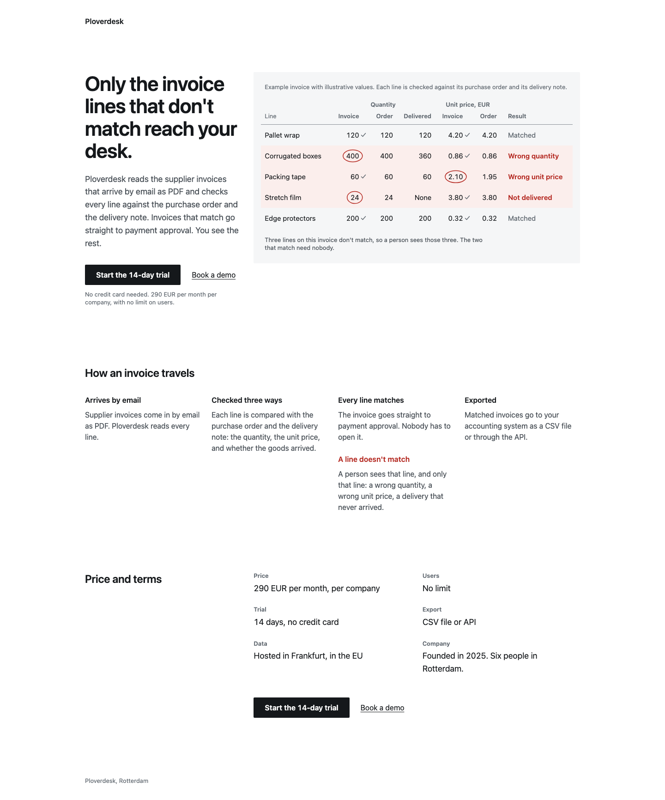 | 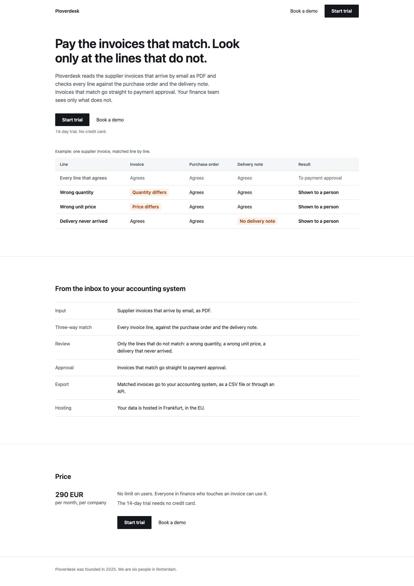 |
| 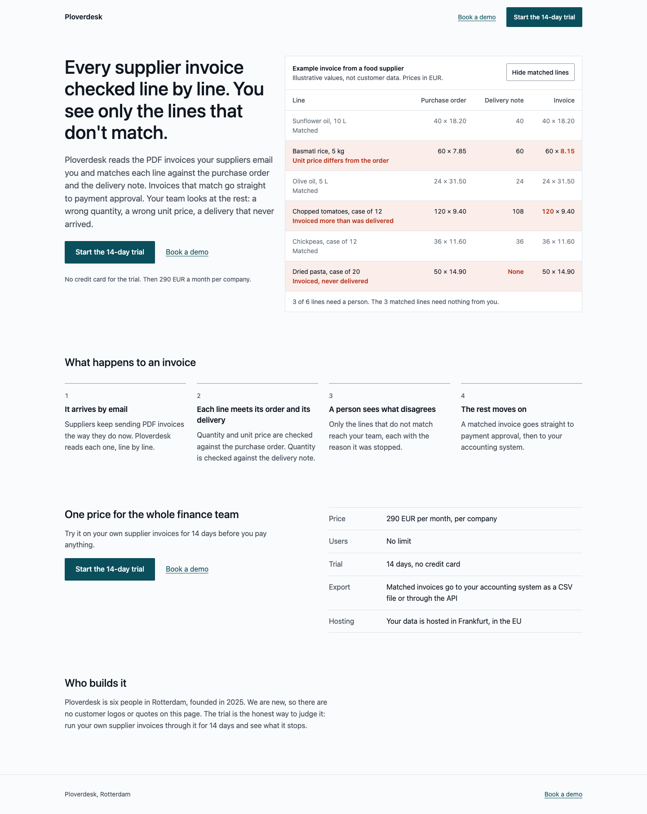 | 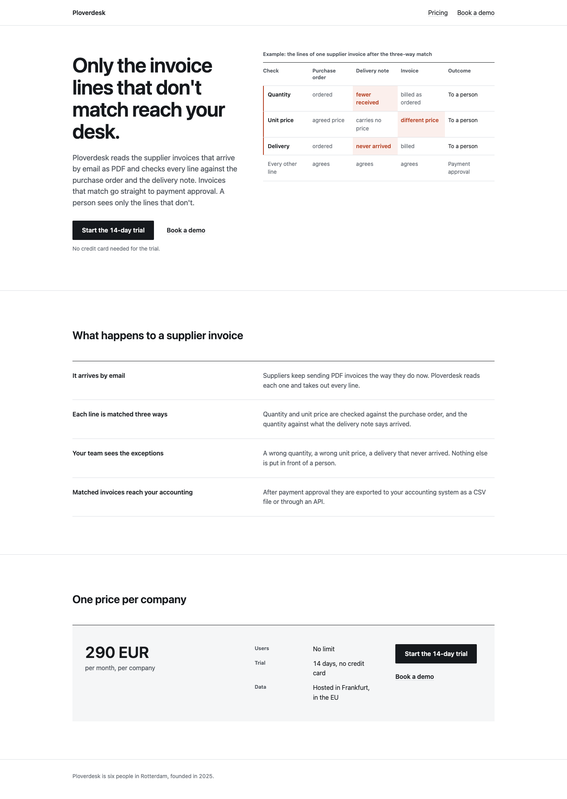 |

- **Arm A.** Both pages show an example invoice with invented quantities and unit prices (five lines in run 1, six in run 2, with invented product names), labelled "Example invoice with illustrative values" and "Illustrative values, not customer data". Both final reports flag it: each says it read "invent no figure" as covering claims about the company, and that the example has to go if the founders meant it literally. This is the round 3 behaviour again: the review edits did not change it.
- **Arm B.** Both pages keep an example on the first screen, labelled as an example, and its cells hold words: "Agrees", "Quantity differs", "Price differs", "No delivery note" in run 1; "ordered", "fewer received", "different price", "never arrived" in run 2. The only figures in the source of either page are the brief's: 14 days, 290 EUR, 2025. Both runs name the example in `Allowed patterns:` of their `MASTER.md`.

### Judging

Same judge as before (one Claude model, three roles, each in its own session, letters shuffled), with three differences, so **round 4 scores are not comparable with rounds 1 to 3**:

- Each role was asked to list every figure on the page that the brief does not give, and was told: "The brief says to invent no figure: weigh that as the brief's author would." Rounds 1 to 3 did not say this.
- The judges saw two stills per page (whole page at 1440 px and at 390 px), not three.
- The sets are different. M1: arm A run 1, arm B run 1, `frontend-design` run 1, none run 1. M2: arm A run 2, arm B run 2, `frontend-design` run 2, genjutsu 4.1.3 run 1. There is no 4.1.3 page in M1 and no no-plugin page in M2.

The per-role scores and the letter map are in [`judging/scores.json`](./judging/scores.json). The map was checked by hashing the 16 stills of the blind sets against the `media/` folders. Every mean below was recomputed from the three raw votes.

**Set M1**

| Page | Designer | Founder | Slop hunter | Mean | Roles that listed a figure outside the brief |
|---|---|---|---|---|---|
| arm B run 1 | 8 | 8 | 8 | 8.0 | 0 of 3 |
| none run 1 | 7.5 | 7.5 | 7 | 7.33 | 3 of 3 (line counts of its illustration; no quantity, no price) |
| frontend-design run 1 | 7 | 7 | 6 | 6.67 | 3 of 3 |
| arm A run 1 | 6.5 | 6.5 | 6.5 | 6.5 | 3 of 3 |

**Set M2**

| Page | Designer | Founder | Slop hunter | Mean | Roles that listed a figure outside the brief |
|---|---|---|---|---|---|
| arm B run 2 | 8 | 7.5 | 8 | 7.83 | 0 of 3 |
| genjutsu 4.1.3 run 1 | 7 | 7 | 7 | 7.0 | 0 of 3 |
| arm A run 2 | 7 | 7 | 6.5 | 6.83 | 3 of 3 |
| frontend-design run 2 | 6.5 | 6.5 | 6 | 6.33 | 3 of 3 |

### What round 4 says

- **Arm B against arm A:** +1.5 and +1.0. All six votes put the arm B page above the arm A page of its set.
- **Arm B is first in both sets**, in every vote: +1.33 and +1.5 over `frontend-design`, +0.67 over the no-plugin page in M1, +0.83 over the 4.1.3 page in M2.
- **Arm A is not.** It is below the no-plugin page in M1 (6.5 against 7.33) and below the 4.1.3 page in M2 (6.83 against 7.0), and level with `frontend-design` (-0.17 and +0.5).
- **The instruction moved the pages that never changed.** From round 3 to round 4 the 4.1.3 page of set M2 went from 4.33 to 7.0, the no-plugin page of M1 from 5.83 to 7.33, and the two `frontend-design` pages from 7.33 and 7.17 to 6.67 and 6.33. In both sets the pages on which no role found a quantity or a price sit above those where all three did. Round 4 ranks first by whether a page obeys "invent no figure". That is what the instruction asked, and it is why these scores cannot be set beside round 3.
- **Cost:** arm B $1.95 and $1.93, arm A $2.19 and $2.07, against $0.46 for no plugin and $0.64 to $0.68 for `frontend-design`. Arm B is at about 4.2 times a no-plugin run. Two runs per arm do not show that the bound makes a run cheaper.
- **The reading lines still do not open the report.** None of the four final reports opens its checked group with the six labelled entries, although the text both arms ran says "a report asked short keeps them, one line each". One of the labels appears as a plain bullet in three of the reports (`First screen:` twice, `The one motion:` once); none carries a `file:line`.

## What this does not show

- **Not that genjutsu is ahead of frontend-design.** The lead is 0.17 and 0.5 points. The pages that never changed moved by more than that from one judging round to the next: the mean of the same minimal-saas page shifted by up to 0.83 (none run 1: 6.67, 6.33, 5.83), and the 4.1.0 nocturne page by 1.5 (5.67, 4.17, 5.33). The anchors also drifted down in round 3: the two `frontend-design` pages averaged 7.75 in rounds 1 and 2 and 7.25 in round 3 without changing. In set M1 the candidate gained 0.17 between rounds 2 and 3 and `frontend-design` lost 0.33: most of the "overtaking" is the anchor moving.
- **Round 4 is a different measurement.** Its judges were told to weigh "invent no figure" as the brief's author would, saw two stills per page instead of three, and scored sets with a different make-up, on a newer Claude Code (2.1.325 against 2.1.323). No round 4 score can be set beside a score of rounds 1 to 3. The instruction also points at the one thing arm B was written to fix: a page with no invented figure was going to gain from it. The 4.1.3 page of set M2, a column of text with no example at all, rose from 4.33 to 7.0 under it without changing. Round 4 shows that the bound removes the invented figures and that the example survives as words; it does not show that a reader not given that instruction would prefer the arm B pages to the round 3 pages.
- **Two runs per arm.** With the same rules, the two round 2 runs scored 7.33 and 6.17. Two runs do not separate that from a real difference, and the candidate had six draws on this brief of which the last two are reported as the round 3 result. Round 4 adds two draws per arm. The bound held in two runs of two; that is all that is known about how often it holds.
- **The judge is a model.** One Claude model in three roles, each role seeing all four sets in one session. Its three scores usually sit within a point of each other, which is agreement between prompts, not independent confirmation. No human panel. Scores are relative to the set they were given in.
- **Tuned on this case.** The rules were written after reading the winning pages, then tuned for three rounds on this one brief against the same two `frontend-design` pages. The bound of round 4 was written for this brief's own sentence, "invent no other figure", and tried on this brief only. The new pages converged on them: the same kind of example table, in one run the same headline. This is an in-sample result. Nothing here says what the rules do on a brief they were not tuned on.
- **The held cases only check for regressions.** One candidate run per case per round. On etale-landing the difference was −0.17, +0.17 and +0.33 over the three rounds, with at least one role of three preferring the old page each time: no measurable gap. On nocturne-planetarium the candidate scored 4.83, 8.33 and 6.83 from round to round. Quoting round 2's 8.33 against 4.17 as a gain would be picking a draw. The 4.1.0 etale page also overflows sideways on a phone (421 px in a 390 px frame), which helps the candidate a little in set E.
- **Cost.** The factor over no plugin rose, from about 3.7 to about 4.3 on this brief. Over the six candidate runs on it a run cost $1.94 to $3.07; on the held cases, $2.47 to $3.13. The arm it is level with, `frontend-design`, costs $0.64 to $0.68. In round 4 the four runs cost $1.93 to $2.19: about 4.2 times a no-plugin run for arm B, 4.5 to 4.8 for arm A.
- **Through round 3, the example invoice uses made-up values.** The brief says "invent no other figure". Both round 3 pages show quantities and unit prices that come from nowhere (seven lines in run 1, six in run 2), labelled "The values are illustrative" and "Illustrative lines, not customer data", and both runs said so in their reports. This is the same breach the baseline held against `frontend-design`, and "no invented figure" was one of the things 4.1.3 did right: the new pages no longer have it. Part of the round 3 gain comes from adopting that breach, and the round 3 judges did not penalise it. Run 2's prices also carry no currency. In round 4 the two arm A pages do the same on the edited text. The two arm B pages do not, and theirs is the v4.2.0 text; but the round 3 scores quoted in section 5 belong to pages with the breach, and no page without it was scored under the round 3 instruction. An example in words is also a thinner picture than an invoice with values: whether it explains the product as well was not asked.
- **Version gap.** Three different things are compared under one name. The baseline is 4.1.3 (`5e00595`); the candidate is a branch on top of 4.1.4, which also added a feedback link to the final report; the v4.2.0 text is that branch at `1548e63` (round 4's arm B) plus merges that edit native modules and add an audit check no run here had, and it was run on `minimal-saas` only, twice, never on the held cases. The two held "old" pages are older still: genjutsu 4.1.0, Claude Code 2.1.289, a month earlier, each picked from two runs when it was published, and their briefs use the "Up-front answers to the gates" wording while the minimal brief does not.
- **The reading lines are not printed on minimal-saas.** The new static reading is meant to appear in the final report as labelled lines. The minimal brief asks for "a short report", and neither round 3 run printed them, so on this case there is no trace that the reading took place beyond its effect on the page. The etale and nocturne reports, which ask for the full report, carry the labelled lines. The text of round 4 says a report asked short keeps them, one line each; none of its four reports does.
- **One failed grader, one U+2014.** `minimal-saas-candidate-r3-2`, the higher scored of the two round 3 pages, failed the `paint-loaded` grader (score 0.67): its trace does not show that the modules `paint` asks for were loaded. The set M2 result rests on that run. The same run wrote one U+2014 in its final message, against genjutsu's own rule (the committed copy holds the character reference). The 4.1.3 run 2 failed the same grader. The four round 4 runs passed all three graders.
- **Judged on stills.** Scroll, hover and on-load motion were not seen by the judges. Visible defects in the round 3 stills: on a phone, run 2's "Book a demo" wraps to two lines in the header, against the button; run 1's example starts below the first phone screen. In round 4, both arm B examples start below the hero on a phone: the first phone screen of run 1 shows only the agreeing line and the title of the first mismatch, and that of run 2 shows the first mismatch. On a desktop, arm B run 1 leaves the right of its hero empty and arm B run 2 has no trial button in its header.
- **Headless, web, one model, one day.** No run could build or look at its own page. This is `paint` with nobody to talk to, which is not how it is meant to be used; the conversation examples in this repository are the other half of the picture. Nothing was measured in conversation, on `cast` or `bunshin` (which carry two of the changed regions), or on Compose or SwiftUI. Captured on macOS, where `frontend-design`'s Avenir Next is present.

The sentences this supports. Round 3: on one minimal landing brief, run headless, the pages no longer come out empty; scored blind by a model in three reviewer roles, the two new pages are 2.3 and 3.3 points out of 10 above the 4.1.3 pages, 1.7 and 2.0 above the no-plugin pages, and level with `frontend-design`, for about 2 USD a run against 0.66 and 0.46; their example invents its values. Round 4: with one more sentence in the text, two runs of two keep the example and invent no figure; judges told to hold the brief's "invent no figure" against a page put both first in their set (8.0 and 7.83 out of 10), and the same text without the sentence at 6.5 and 6.83.

## Layout of this folder

```
COMPARE.md               this file
bin/
  run-arm.sh             runs one arm of one case (billed)
  trace-facts.py         what a run's session had loaded, its Skill calls, cost and last message
  hygiene.py             repository rules applied to a run folder before it is committed
  capture.sh             builds a workspace, shoots it, runs the tells audit
  capture-cast.sh        builds an invoice-mark-paid workspace and shoots one click
cases/minimal-saas/      the case: case.yaml, fixture.sh, prompt.md, graders/
arms/                    the empty plugin of the none arm; the extra grader of the frontend-design arm
compare/                 the baseline's side-by-side images
judging/scores.json      the blind scores of the four rounds, per role, with the letter-to-run maps
<case>-<arm>-<n>/        a baseline run (arms none, frontend-design, genjutsu)
<case>-candidate-r<round>-<n>/   a run of the branch in a tuning round (round 4: r4a and r4b, its two arms)
  receipt.md, receipt.json
  runs/<UTC stamp>/      run.log, report.html, aggregate-result.json, prompt.md (as sent),
                         trace-facts.json, workspace-1/ (without node_modules and dist)
  media/                 the stills; shots.json and build.log beside them or in the run folder
  tells.md, tells.json   the tells audit
invoice-mark-paid-genjutsu-20261004/   stills of the existing genjutsu run, for the cast pair
```

Raw output follows the repository's rules: paths into the repository are relative to its root, each U+2014 in the CLI's own output became " - ", and no trace is committed. One rule is added: where a run itself wrote a U+2014, the committed copy holds the character reference `&#8212;`, which renders as the same dash; each receipt counts them.

To run an arm again (billed), after `bin/make-templates.sh`:

```sh
GENJUTSU=/path/to/genjutsu baseline-2026-11/bin/run-arm.sh genjutsu minimal-saas 3
FRONTEND_DESIGN=/path/to/frontend-design baseline-2026-11/bin/run-arm.sh frontend-design minimal-saas 3
baseline-2026-11/bin/run-arm.sh none minimal-saas 3
python3 baseline-2026-11/bin/trace-facts.py /private/tmp/e-XXXXXX/out/trace.jsonl > baseline-2026-11/minimal-saas-none-3/runs/<stamp>/trace-facts.json
python3 baseline-2026-11/bin/hygiene.py baseline-2026-11/minimal-saas-none-3
baseline-2026-11/bin/capture.sh baseline-2026-11/minimal-saas-none-3 /path/to/genjutsu
```

A candidate run adds `ARM_LABEL=candidate-r<round>` to the genjutsu line and points `GENJUTSU` at the branch checkout. The round 4 runs used `candidate-r4a` and `candidate-r4b`, with `MAX_COST_USD=3.4`.
